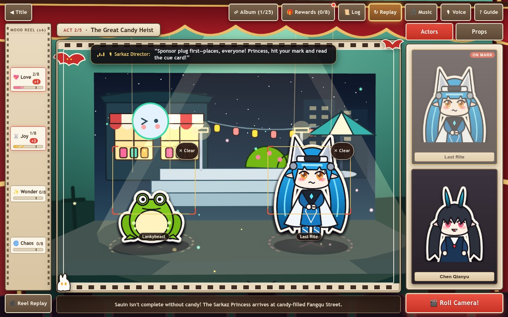

# New Era for the Myriad Souls — Endfield Sauin Film Studio

**Play Live:** [https://kunruiw1991.github.io/endfield-sauin-studio/](https://kunruiw1991.github.io/endfield-sauin-studio/)



A complete, zero-build 3D Pop-Up Puppet Theater & Interactive Filmmaking Comedy web game in **100% English with full Neural English Voiceover (`52` voiced clips)**, inspired by *Arknights: Endfield*'s seasonal **Sauin** (All Souls' Eve / Halloween) mini-game event (*"New Era for the Myriad Souls"* / Bilibili `BV13Dxt6AERw`).

## Features

- **5 Theatrical Acts & 20 Animated Stage Takes**: Direct **Last Rite**, **Camille**, **Chen Qianyu**, **Rossi**, **Mi Fu**, **Yvonne**, and **Ardashir** across 5 multi-layered Three.js 3D diorama sets (*Sarkaz Study*, *Fangqu Street*, *Moonlit Wilderness Camp*, *Endfield Outpost Avenue*, and *Cliff Beneath Talos*).
- **4 Cumulative Mood Gauges & 5 Branching Illustrated Endings**: Balance or push **Love**, **Joy**, **Wonder**, and **Chaos** across your 5-act shoot to unlock:
  - `//END1` **Strange Sauin** *(Balanced run)*
  - `//END2` **The Sauin Universe** *(High Love)*
  - `//END3` **An Unending Parade** *(High Joy)*
  - `//END4` **Sauin & Sarkaz** *(High Wonder)*
  - `//END5` **Sauin Never Exists** *(High Chaos)*
- **Full Neural English Voiceover (`52` Clips) + Synchronized Cinema Subtitles**: Every pre-shoot stage cutscene, studio callout, all 20 filmed takes, and all 5 endings are fully voiced in expressive English (`assets/vo/*.mp3` + `assets/vo/manifest.json`), paired with an original WebAudio **E♭-minor 124.4 BPM Halloween March** that auto-ducks cleanly under speech.
- **1-Tap Repeat & Replay Controls Across Every Screen (`R` Shortcut)**: Re-listen to any spoken English line or re-watch any animated stage take on demand via **`🔊 Replay Intro`** on Title, **`🔊 Replay`** + **`◀ Prev`** in cutscenes, **`↻ Replay`** in the global top bar, per-line **`🔊`** + **`🎥 Replay Cutscene`** in the Dialogue Log, **`🎥 Reel Replay`** (`🎥 Cutscene` on mobile) on the stage HUD, **`🔊 Replay Take`** on Take Result cards, **`🔊 Replay Voice`** on Ending Polaroids, and **`🔊 Replay VO`** inside the Film Album (with automatic VO unmute on explicit replay tap and live `.is-speaking` visual pulse).
- **Film Album (`20/20` + `5/5`) & Studio Commissions (`300 Oroberyl`)**: Replay any unlocked take or ending with illustrated mini-Polaroid thumbnails, jump directly to any Act after your first wrap, trigger interactive 3D background stage gags, and export souvenir Polaroid postcards (with iPad/iOS touch-and-hold preview modal).
- **Zero-Build & Touch/Desktop Ready**: Pure ES2022 modules + vendored Three.js r170 (`vendor/three.module.min.js`), dual **Drag-and-Drop + 1-Tap Casting**, responsive across desktop (`1280×800`, `1024×768`), iPad portrait (`768×1024`), and mobile landscape/portrait (`844×390`, `390×844`) viewports.

## Quick Start (Local)

Serve the repository root with any static HTTP server:

```bash
python3 -m http.server 8080
```

Then open [http://localhost:8080](http://localhost:8080) in any modern browser.

## Automated E2E & Fun-Gate Verification

Run the headless Chrome CDP verification suite (14 numeric gates covering boot, video-run parity, all 20 takes, all 5 endings, drag/tap casting, 52/52 VO clips, 9 Replay surfaces + `10×` rapid replay burst, caption sync & BGM ducking, zero CJK characters, 60 Hz determinism, 5 viewports × 10 screens = 50/50 layout checks, and WebGL performance):

```bash
PYTHONDONTWRITEBYTECODE=1 python3 tests/sim_gates.py
```

## Controls

- **Mouse / Touch**: Drag an **Actor** card and a **Prop** card onto their red-bracketed stage marks (or simply **tap** a card to cast it immediately), tap background stage gags for bonus Halloween surprises, press **Roll Camera!**, and tap any **🔊 Replay** / **↻ Replay** / **◀ Prev** button to re-listen to English voiceover or re-watch stage choreography without losing progress.
- **Keyboard Shortcuts**:
  - `Space` / `Enter` — Advance cutscene dialogue or press **Roll Camera!** / **Next Act**
  - `R` — Replay the active screen's English voiceover line or animated stage take
  - `1` / `2` — Cast Actor 1 / Actor 2
  - `3` / `4` — Cast Prop 1 / Prop 2
  - `Esc` — Close open modal (`Film Album`, `Event Rewards`, `Dialogue Log`, `Guide`, `Postcard`)
